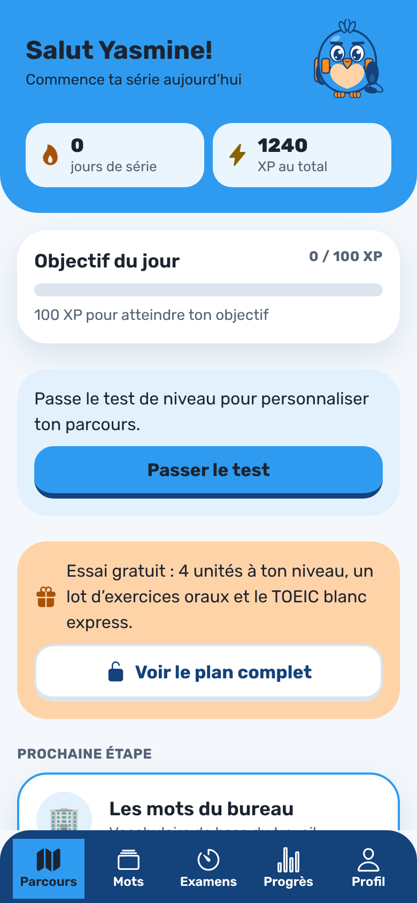
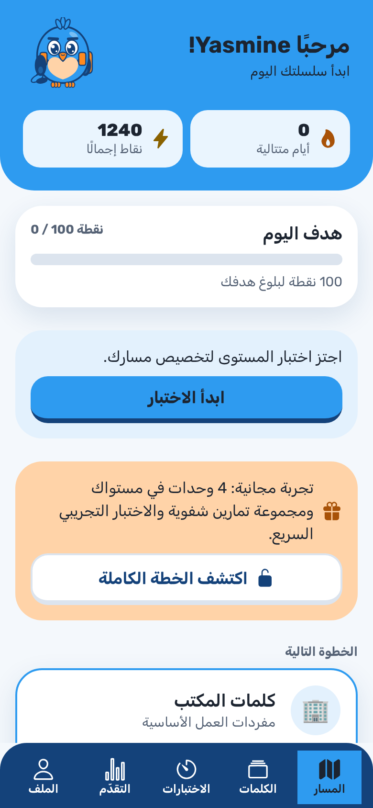
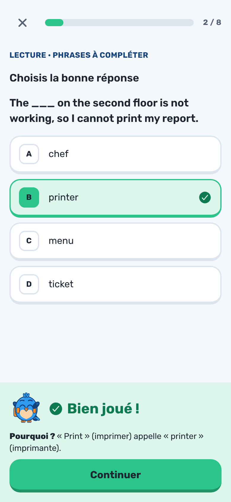
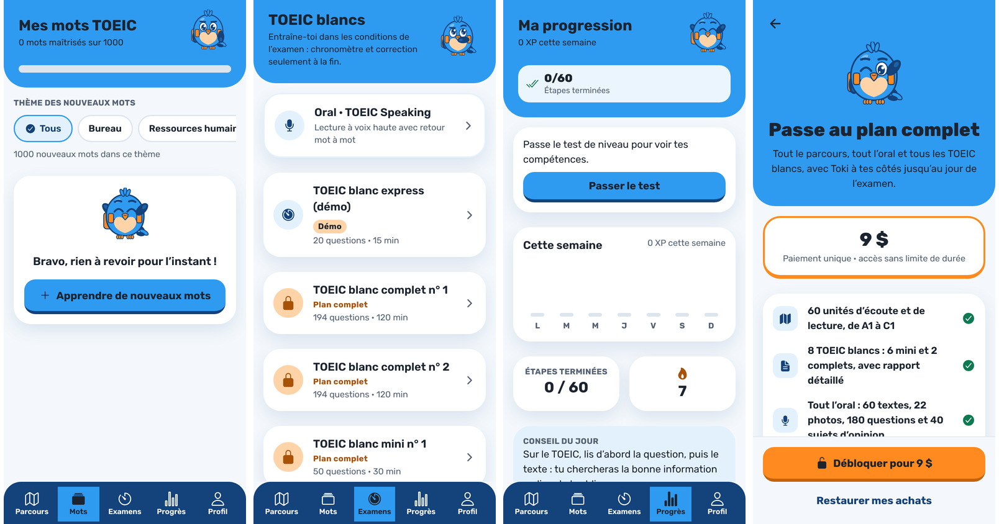
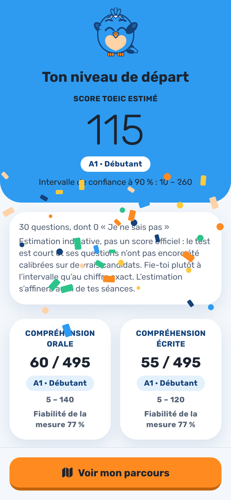

# Direction visuelle : « Ciel ludique » avec retour de jeu

Choisie le 2026-10-11 parmi trois pistes. Les maquettes sont sur la planche « TOEIC Quest – Directions visuelles » : A · Ciel ludique, B · Jeu énergique, C · Premium épuré.

La direction retenue combine :

- **la structure de A** : bandeau Bleu Ciel en tête d'écran, cartes blanches flottantes, barre d’onglets blanche ;
- **le retour de jeu de B** : boutons et options en relief, bande de retour colorée avec Toki, pastille de combo ;
- **la sobriété de C** pour les chiffres de résultat : grand chiffre en graisse légère, peu d'ornements.

La palette du brief Toki ne change pas. Ce sont son dosage et les formes qui changent.

## Jetons (`src/theme.ts`)

| Jeton | Avant | Après |
| --- | --- | --- |
| Police | système | **Rubik** (latin et arabe), graisses 300 à 800 |
| `radius` | 10 / 16 / 24 | 12 / 18 / 28 |
| `shadow` | `0 4 12`, encre 8 % | `0 10 28`, Bleu Nuit 12 % |

- Une police chargée a un fichier par graisse. `AppText` et `EnglishText` choisissent donc la famille Rubik d'après `fontWeight` (`fontFamilyFor`). Il ne faut pas fixer `fontFamily` à la main, sauf pour un `Text` ou un `TextInput` brut ; dans ce cas, utiliser `fonts[600]`, etc.
- Seules les 6 graisses utilisées sont embarquées (`App.tsx`). Si leur chargement échoue, le texte s'affiche dans la police système.

## Composants (`src/components/ui.tsx`)

- **`Screen hero={…}`** : bandeau Bleu Ciel aux coins inférieurs arrondis, qui va jusque sous la barre d'état. Le texte y est en Encre (5,3:1).
- **`StatTile`** : chiffre et légende sur fond blanc translucide, à placer dans le bandeau.
- **`Screen footerTone`** : colore la bande du bas, par exemple en vert ou en rouge doux pour le retour sur une réponse.
- **`ProgressBar`** : se remplit avec une animation. L'animation est coupée si le réglage système « Réduire les animations » est actif (`useReducedMotion`).
- **`Button`** : il était déjà en relief et le reste.

## Écrans touchés

- **Accueil** : bandeau avec salutation, série et Toki, plus 2 ou 3 tuiles (série, XP, score estimé).
- **Exercices** :
  - options en relief plus épais, lettre dans un carré arrondi qui se colore ;
  - bande de retour pleine largeur, avec Toki joyeux ou encourageant et une pastille orange de combo.
- **Fin de série** : précision en grand chiffre léger, XP sur une tuile Or Score, bouton principal Orange Soleil.
- **Onglets** : barre blanche aux coins supérieurs arrondis, avec une ombre légère vers le haut. L’onglet actif est dans une pastille bleu ciel clair, en Bleu Nuit. (La barre Bleu Nuit du premier lot a été abandonnée.)

| Accueil (fr) | Accueil (ar) | Retour sur une réponse |
| --- | --- | --- |
|  |  |  |

## Règles

- Le bleu domine. L'orange marque l'action principale de l'écran (`variant="play"`). L'or reste réservé aux récompenses.
- Les nouveaux contrastes sont vérifiés dans `src/theme.test.ts`.
- Chaque écran retouché est vérifié en arabe : Toki doit apparaître en miroir et les chiffres doivent être alignés sur leur légende.

## Lot 2 (2026-10-11)

- **Bandeau sur les onglets Mots, Examens et Progrès.** Il est construit avec `HeroTitle` : titre, ligne d'information et Toki.
  - Progrès regroupe ses chiffres dans le bandeau : score estimé, étapes terminées et série.
  - Mots affiche dans le bandeau sa barre « mots maîtrisés ».
- **Toki animé** (`Mascot`, avec `react-native-reanimated` 4.5.1 et `react-native-worklets` 0.10.1) :
  - au repos, il flotte doucement ;
  - sur une bonne réponse, il fait un bond et se dandine ;
  - sur une erreur, il penche la tête ;
  - il reste immobile quand le réglage « Réduire les animations » est actif.
- **Confettis** (`src/components/Confetti.tsx`).
  - Ils apparaissent :
    - en fin de série quand une unité est terminée ou qu'un nouveau niveau est atteint ;
    - à l'arrivée sur le résultat du test de niveau.
  - Une seule salve, aux couleurs de Toki. Ils ne captent pas les touches et sont désactivés quand le réglage « Réduire les animations » est actif.
- **Résultat du test de niveau** :
  - le score s'affiche en grand chiffre léger dans le bandeau, avec le niveau CECR dans une pastille blanche et l'intervalle de confiance ;
  - les précautions de lecture passent dans une carte sous le bandeau ;
  - le bouton principal est Orange Soleil.
- **Paywall** :
  - l'offre est dans le bandeau ;
  - le prix est dans une carte à bord Orange Soleil, placée avant la liste des avantages ;
  - chaque avantage est coché en vert.

| Onglets et Paywall | Résultat du test de niveau |
| --- | --- |
|  |  |

## Suite

1. Faire clignoter Toki : il faut animer les yeux dans `Toki.tsx`, donc des propriétés SVG animées.
2. Étendre le bandeau aux écrans Profil, Oral et TOEIC blanc en cours.
3. Tester les animations sur un appareil Android d'entrée de gamme (objectif : 60 images par seconde).
